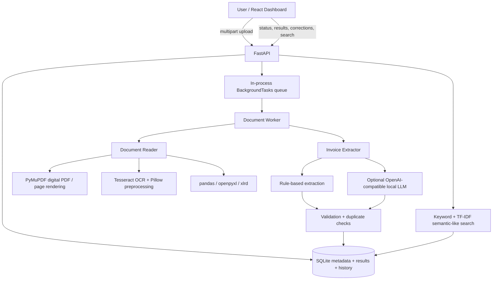

# InvoiceAI Architecture

## Design decisions
- Python/FastAPI was selected for a single-language document/OCR/AI backend and automatic OpenAPI docs.
- SQLite keeps local setup simple. PostgreSQL is the recommended production migration target.
- The current worker uses FastAPI `BackgroundTasks`; it is suitable for a small single-process assessment MVP, not a durable distributed queue. For production, move jobs to Celery/RQ with Redis and persist retry state.
- Keyword search is exact/sub-string based. The optional semantic mode currently uses TF-IDF lexical similarity, not a neural embedding/vector database. This limitation is disclosed.
- The local LLM adapter uses an OpenAI-compatible chat-completions endpoint (e.g. llama.cpp server). The heuristic extractor remains the fallback and marks its use in `confidence_notes`.
- Uploads are size-limited and stored under a generated filename. Production deployment additionally needs authentication, malware scanning, rate limits, private object storage, and tenant isolation.
