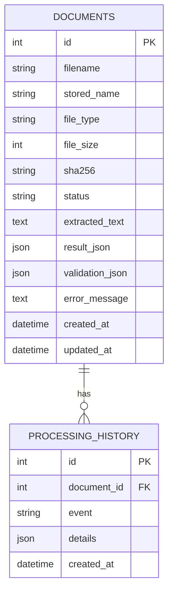

# Database Schema



SQLite stores JSON payloads as serialized JSON text. `documents.sha256` is indexed for duplicate-file detection; `documents.status` is indexed for job filtering. `processing_history.document_id` references `documents.id` with cascading deletion.

## Invoice JSON shape
```json
{
  "invoice_number": null,
  "invoice_date": null,
  "supplier_name": null,
  "customer_name": null,
  "subtotal": null,
  "tax": null,
  "total": null,
  "currency": null,
  "line_items": [],
  "confidence_notes": []
}
```
